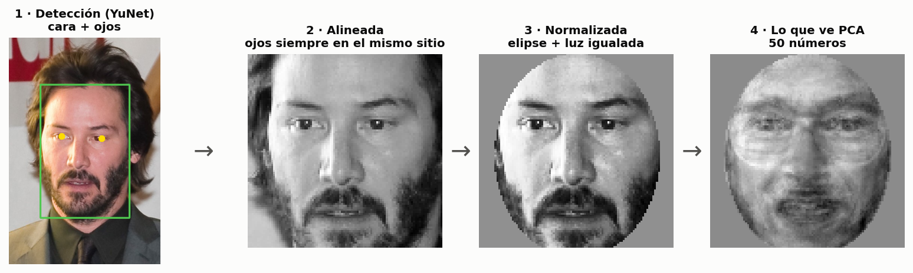
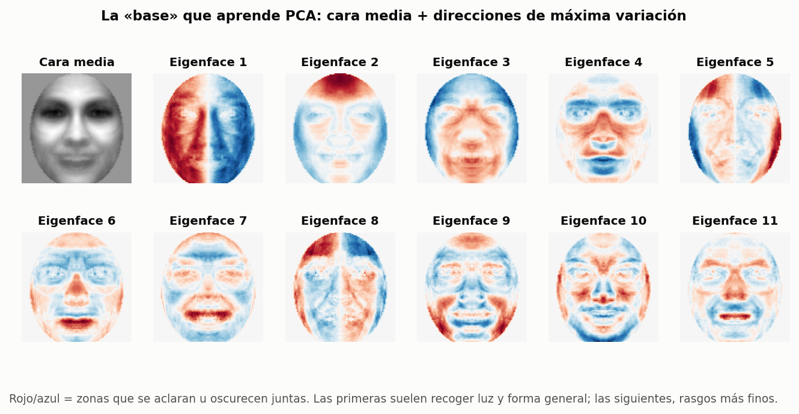
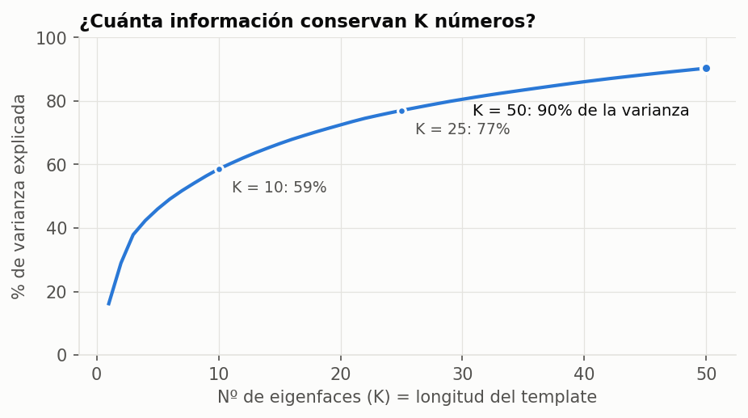
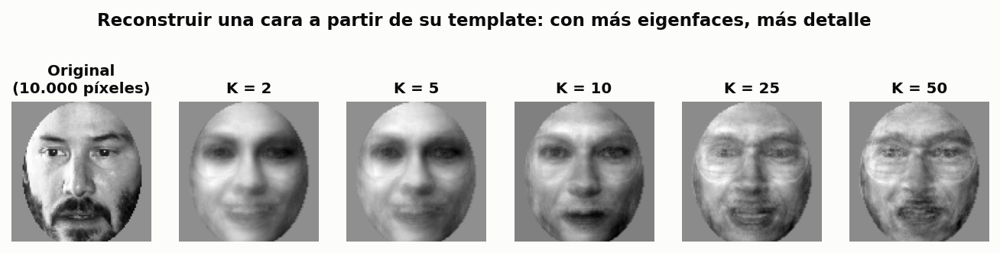
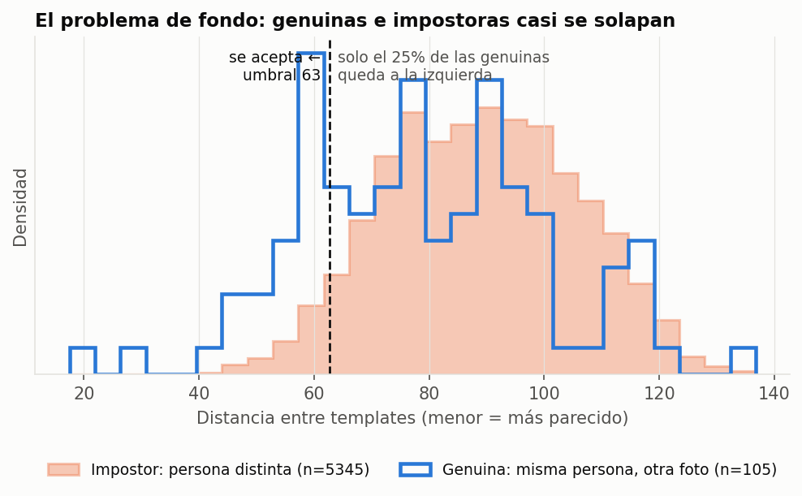
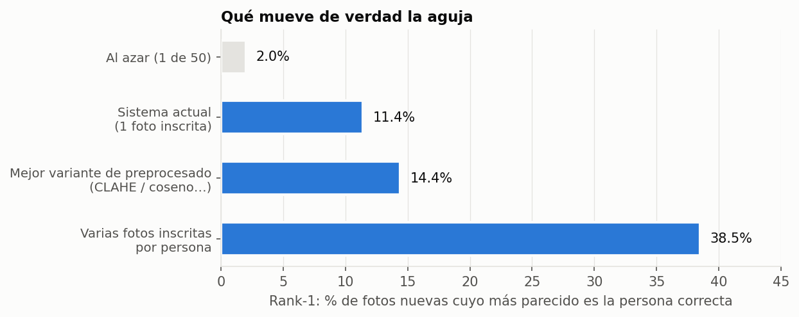
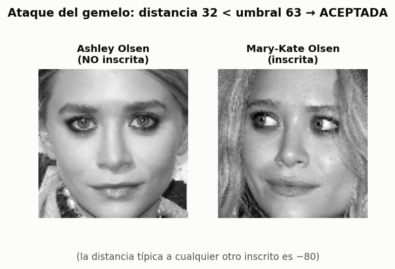

# Reporte: reconocimiento facial con PCA

> Estado a 31-10-2026 · rama `feat/modelo-basico` · 50 personas inscritas (49 del profe + Álvaro Arbeloa).
> Figuras generadas con `python evaluacion/figuras_reporte.py` (se pueden regenerar en cualquier momento).

**En una frase:** el sistema funciona de punta a punta (detecta, alinea, extrae, compara y decide),
pero PCA con **una sola foto por persona** reconoce bien a alguien en una foto *distinta* solo en
~1 de cada 9 casos. El preprocesado ya no es el cuello de botella; lo que más ayuda es tener más
fotos de cada persona.

| | Valor |
|---|---|
| Fotos del profe con cara detectada | **49 / 49** (con YuNet) |
| Acierto rank-1 con fotos nuevas | **11.4 %** (azar: 2 %) |
| EER | **41 %** |
| Rechazo de personas inscritas (umbral actual) | **75 %** |
| Ataque del gemelo (Ashley → Mary-Kate Olsen) | **funciona** |

---

## 1. Cómo funciona

### 1.1 La cadena completa

1. **Detección** (YuNet, una red pequeña de OpenCV): encuentra la cara y la posición real de los ojos.
2. **Alineado**: rota y escala la foto para que los ojos queden *siempre* en el mismo píxel
   (30 % y 70 % del ancho, 36 % del alto). Así comparamos caras, no poses.
3. **Normalización**: gris, 100×100, ecualización, máscara elíptica (fuera pelo y fondo) y
   media 0 / desviación 1 (fuera brillo y contraste globales).
4. **Extracción PCA**: la cara (10.000 píxeles) se resume en un **template de 50 números**.
5. **Comparación**: distancia euclídea entre templates. Si es menor que el **umbral**, se acepta.

Los 9 métodos del enunciado son esta misma cadena entrando por distintos puntos: el normal entra
por el paso 1, los `_sd` por el paso 3 y los `_t` directamente por el paso 5.

### 1.2 Qué es PCA (eigenfaces)

Una cara normalizada es un punto en un espacio de 10.000 dimensiones, pero las caras no ocupan
todo ese espacio: se parecen mucho entre sí. PCA busca las pocas **direcciones en las que más
varían las caras** y descarta el resto.

- **Entrenar** = calcular la **cara media** y las **eigenfaces** (las direcciones de máxima
  varianza) a partir de un conjunto de caras. No usa etiquetas ni iteraciones: es un SVD y tarda
  segundos. Nosotros entrenamos con las 49 + 1 caras inscritas y sus espejos.
- **Extraer** = restar la cara media y proyectar sobre las K primeras eigenfaces:
  `template = eigenfaces · (cara − media)`. Cada número dice "cuánto de esta eigenface tiene la cara".
- Fijaos en la **eigenface 1**: mitad roja, mitad azul. Es la *luz lateral*. PCA no sabe qué es
  identidad y qué es iluminación; solo ve varianza. Esto explica buena parte de sus limitaciones.

¿Cuántas eigenfaces? Con 50 se conserva el 90 % de la varianza de las caras de entrenamiento:

Y el camino inverso, **reconstruir** una cara desde su template (`media + template · eigenfaces`),
muestra lo que el sistema "ve" de cada persona:

Dos cosas importantes salen de esta figura:

- Con 50 números la cara es reconocible, pero aparecen "fantasmas" de otras caras del
  entrenamiento (se ven gafas que Keanu no lleva): **PCA solo sabe describir caras como mezcla de
  las que ha visto**, y solo ha visto 50.
- Si un atacante lee el `.csv` (templates) y tiene el modelo (público), **puede reconstruir la cara
  de cada inscrito**. Es el ataque de inversión de la sección 3.3.

### 1.3 Decidir: verificar e identificar

- **Verificar(id, foto)**: distancia al template de ese id ≤ umbral → sí / no.
- **Identificar(foto)**: el inscrito más cercano, **solo si** está por debajo del umbral; si no,
  "desconocido". La "confianza" que muestra la interfaz es relativa (cuánto destaca el primero
  sobre el resto): siempre hay un favorito, incluso para un desconocido, así que lo que manda es el umbral.
- El umbral actual (**63**) es provisional: acepta al 2 % de los pares de personas distintas.

---

## 2. Cómo lo hemos medido

El dataset del profe trae **una foto por persona**, así que con él solo no se puede saber si el
sistema reconoce a alguien en otra foto. Montamos un **anexo de pruebas** con
`scripts/descargar_anexo.py`:

- ~109 fotos de **Wikimedia Commons** (licencias libres, autor en `datos/pruebas/fuentes.csv`)
  de 44 personas inscritas, más dos **gemelos no inscritos** (Oliver Phelps y Ashley Olsen).
- Filtros automáticos (una cara clara, sin duplicados, que no sea la foto inscrita) y **revisión a
  ojo**: quitamos dibujos, carteles, un imitador de Michael Jackson y fotos de otra persona.
- 7 personas no tienen fotos en Commons (Twin Melody, Esty Quesada, Eva Hache, Hasbulla,
  Joe Batalan, Josie Totah, Metrika).

`python evaluacion/evaluar.py` da las métricas; `python evaluacion/experimentos.py` compara variantes.

---

## 3. Limitaciones

### 3.1 Descubiertas y ya subsanadas ✅

| Limitación | Cómo apareció | Solución |
|---|---|---|
| Fotos con **formato engañoso**: un AVIF y un WebP con extensión `.jpg` | OpenCV no las abría | Lectura con Pillow, por contenido (no por extensión) |
| Fotos de móvil **giradas** | — (preventivo) | Se aplica la rotación EXIF al leer |
| **Detector Haar** sin cara en 3 fotos y con ojos estimados en 10 (alineado malo) | Samuel L. Jackson, Lady Gaga, Idris Elba…; con tu foto de Adam Pearson, Adam quedaba el 31 de 49 | Detector **YuNet**: 49/49 con ojos reales → Adam sube al puesto 5 (Haar queda de respaldo) |
| Haar confundía el **torso de Isabel II** con una cara | Revisión visual del alineado | Elegir la caja por ojos y acuerdo, no "la más grande"; luego YuNet |
| **Pose, encuadre, pelo y fondo** distintos entre fotos | Revisión de las caras recortadas | Alineado por ojos + máscara elíptica |
| **Brillo y contraste** globales distintos | — | Ecualización + estandarización (la luz *lateral* sigue sin resolverse) |
| OpenCV **no abre rutas con tildes** ("Prácticas") en Windows | YuNet fallaba al cargar | El modelo se lee en memoria |
| Umbral **a ojo** | — | Se calcula con los datos y viaja **dentro del modelo** (`pca.npz`) |
| En la interfaz, subir la **misma foto inscrita** da distancia 0 y parece que todo funciona | — | La web lo detecta (huella SHA-256) y avisa |

### 3.2 Descubiertas y aún sin resolver ⚠️

**a) Una sola foto por persona: el problema de fondo.** La distancia de una foto nueva a su
propia persona se parece demasiado a la distancia a cualquier otra:

Con el umbral actual solo el 25 % de las fotos genuinas se acepta (FRR 75 %); si lo subimos para
aceptar más, empezamos a aceptar impostores. Probamos 72 variantes de preprocesado y distancia
(CLAHE, Tan-Triggs, K = 30/50/80, quitar las 3 primeras eigenfaces, blanqueado, distancia coseno):
**todas entre 11 % y 14 %**, que con 104 fotos de prueba es ruido. En cambio, inscribir varias fotos
por persona **triplica** el acierto:

**b) Gemelos y parecidos.** PCA compara apariencia global; no distingue gemelos.

**c) Otros límites de PCA que el rival probará:**
- Edad (Isabel II 1945, Jordi Hurtado 1985), expresión, gafas de sol (Stevie Wonder), perfil.
- Caras atípicas (Adam Pearson): sigue sin reconocerse con otras fotos.
- **"Hubs"**: algunas personas (p. ej. *metrika*) atraen muchas fotos ajenas porque su template
  está cerca del centro del espacio.
- El **umbral** está calibrado con pocas fotos y sobre el mismo anexo con el que se mide (cifras algo optimistas).

### 3.3 Seguridad: documentadas, **sin implementar** (por decisión del grupo) 🔒

Catálogo completo en [`ataques/README.md`](../ataques/README.md). Las más graves:

| Ataque | Qué necesita el atacante | Estado |
|---|---|---|
| Suplantación escribiendo su template en el `.csv` | Escritura en la BD | **Funciona** (script `ataques/escritura_bd.py`) |
| *Replay*: usar el template de la víctima en `verificar_t` | Lectura de la BD | **Funciona siempre** (distancia 0) |
| **Inversión**: reconstruir la cara desde el template (fig. 1.2) | Lectura de la BD + modelo público | **Funciona** |
| Gemelo / parecido | Una foto | **Funciona** (fig. 3.2 b) |
| Imágenes que no son caras por `_sd`; templates fabricados por `_t` | Acceso a `_sd` / `_t` | Se aceptan (solo se rechazan NaN y tamaños erróneos) |
| Modificar `pca.npz` (incluye el umbral) | Escritura en disco | Lo cambia todo |

---

## 4. Qué haría falta para mejorar

Ordenado por impacto esperado / esfuerzo:

| # | Mejora | Ataca | Esfuerzo | Nota |
|---|---|---|---|---|
| 1 | **Inscribir 2-3 fotos por persona** | 3.2 a | Bajo | Medido: 11 % → 31–38 %. Decidimos no hacerlo para ser fieles al dataset del profe |
| 2 | **Entrenar PCA con un dataset grande** de caras (p. ej. LFW, ~13.000 fotos) | 3.2 a, c | Medio | Eigenfaces más generales, menos "fantasmas" y menos hubs |
| 3 | **Normalizar distancias** (z-norm por persona) | hubs, umbral | Bajo | Reduce que unas pocas personas atraigan todo |
| 4 | **Calibrar el umbral** con un conjunto separado del de medida | umbral | Bajo | Reservar parte del anexo solo para calibrar |
| 5 | **Defensas de la BD**: firma HMAC por fila (clave fuera del repo) y cifrado o *templates cancelables* | 3.3 | Medio | Bloquean suplantación e inversión; pendientes de decidir |
| 6 | **Validar entradas** de `_sd` (¿parece una cara?: error de reconstrucción PCA) y `_t` (¿template plausible?) | 3.3 | Bajo | Rechazar lo que no sea una cara |
| 7 | **Firmar/hashear el modelo** al cargarlo | 3.3 | Bajo | Evita cambiar el umbral a escondidas |

Lo que **no** merece más tiempo: seguir retocando el preprocesado. Está medido que no mueve la aguja.

---

**Créditos de imágenes** (Wikimedia Commons): Keanu Reeves — [Siebbi, CC BY 3.0](https://commons.wikimedia.org/wiki/File:Keanu_Reeves_(Berlin_Film_Festival_2009)_(cropped).jpg) ·
Ashley Olsen — [David Shankbone, CC BY 3.0](https://commons.wikimedia.org/wiki/File:Ashley_Olsen_2011_Shankbone.JPG) ·
Mary-Kate Olsen — [David Shankbone, CC BY 3.0](https://commons.wikimedia.org/wiki/File:Mary-Kate_Olsen_2009_Tribeca_portrait.jpg).
Las fotos han sido recortadas y pasadas a gris. La cara media y las eigenfaces se derivan de las fotos inscritas.
