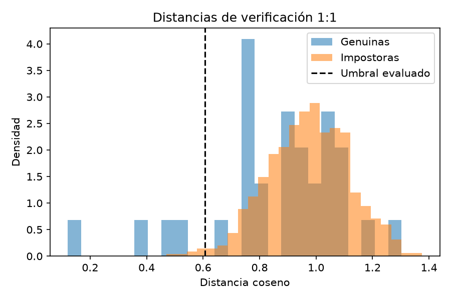
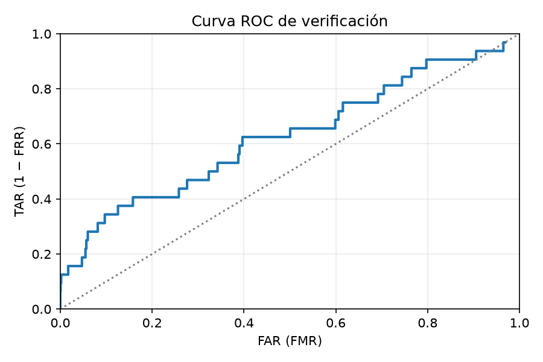
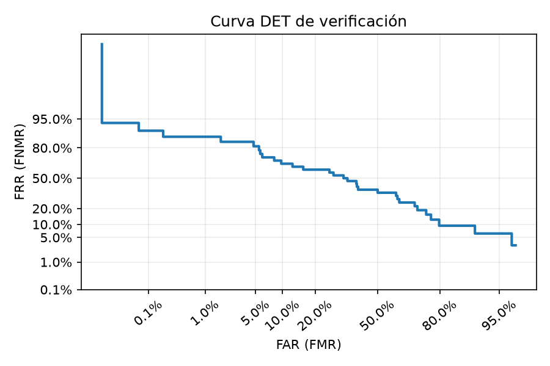
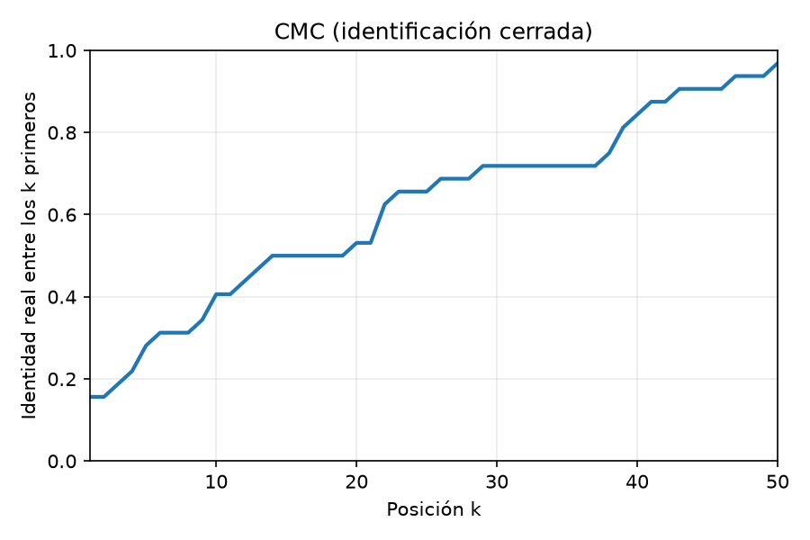

# Evaluación propia del sistema de reconocimiento facial basado en PCA

- **Asignatura:** Sistemas Biométricos
- **Sistema evaluado:** Reconocimiento facial mediante PCA (eigenfaces)
- **Rama de trabajo:** `eval/defensas_v2`
- **Commit de referencia de la evaluación:** `a58e10e`

## 1. Introducción y objetivos

El objetivo de esta práctica es desarrollar y evaluar un sistema de reconocimiento facial que permita realizar operaciones de inscripción, verificación e identificación de personas.

Nuestro grupo ha implementado una solución basada en Principal Component Analysis (PCA), utilizando eigenfaces como método de extracción de características biométricas.

El propósito de esta evaluación es determinar el comportamiento real del sistema, identificar sus fortalezas y debilidades y analizar las limitaciones de la aproximación utilizada.

Se consideran dos dimensiones principales:

1. **Rendimiento biométrico:** capacidad del sistema para reconocer correctamente a las personas.
2. **Seguridad y robustez:** comportamiento frente a entradas problemáticas y posibles ataques contra el sistema.

La evaluación pretende reflejar los resultados observados, incluyendo los errores del sistema.

## 2. Descripción del sistema

### 2.1. Arquitectura

El sistema sigue una cadena de procesamiento facial:

1. Detección del rostro.
2. Alineamiento de la cara.
3. Normalización de la imagen.
4. Extracción de características mediante PCA.
5. Comparación de templates.
6. Decisión utilizando un umbral de distancia.

La detección facial utiliza YuNet y contempla cascadas Haar como mecanismo alternativo.

El preprocesamiento incluye conversión a escala de grises, normalización de tamaño, ecualización y aplicación de máscaras faciales.

### 2.2. Extractor PCA

El extractor PCA ha sido entrenado previamente utilizando imágenes de FairFace, independientemente de las personas inscritas en el sistema.

La representación final combina:

- 50 componentes PCA de la cara completa.
- 50 componentes PCA de una región interior de la cara.

Por tanto, cada template contiene **100 características**.

El modelo conserva aproximadamente el **81 % de la varianza** de su conjunto de entrenamiento.

Es importante señalar que este porcentaje mide la capacidad de PCA para representar las variaciones presentes en las imágenes de entrenamiento. No representa una tasa de reconocimiento ni garantiza que las componentes sean las más adecuadas para distinguir identidades.

Los coeficientes se blanquean y las comparaciones se realizan mediante distancia coseno.

### 2.3. Base de datos

El sistema utiliza una base de datos CSV que almacena los templates asociados a cada identidad.

Los templates se protegen mediante cifrado AES-256-GCM y se utilizan firmas HMAC para detectar modificaciones en los archivos protegidos.

La clave secreta se almacena separadamente de los datos biométricos.

## 3. Metodología de evaluación

### 3.1. Dataset

Se ha utilizado el dataset proporcionado por el profesor, que contiene fotografías de 49 personas.

El grupo ha incorporado una identidad adicional, Álvaro Arbeloa.

El sistema evaluado contiene **50 identidades inscritas**.

### 3.2. Separación de datos

Para evitar evaluar el reconocimiento utilizando fotografías ya inscritas, se ha generado una partición reproducible con semilla `42`.

La distribución obtenida es:

| Conjunto | Fotografías | Identidades |
|---|---:|---:|
| Inscripción | 50 | 50 |
| Calibración | 23 | 23 |
| Prueba final | 32 | 32 |
| Desconocidos | 0 | 0 |

Las fotografías del profesor y la fotografía principal de la identidad adicional se utilizan para inscripción.

Las fotografías adicionales disponibles se reservan para calibración y prueba.

El sistema comprueba mediante un manifiesto y hashes SHA-256 que las fotografías de inscripción coincidan con las utilizadas para construir la base de datos.

Esta comprobación detecta duplicados de contenido exacto, aunque no garantiza detectar imágenes visualmente equivalentes que hayan sido modificadas o recomprimidas.

### 3.3. Procedimiento

La evaluación se ha realizado en las siguientes fases:

1. Generación de las particiones.
2. Montaje del sistema con el conjunto exclusivo de inscripción.
3. Cálculo del umbral provisional.
4. Evaluación del conjunto de calibración.
5. Selección del umbral de funcionamiento.
6. Evaluación del conjunto de prueba final.

El extractor PCA se ha mantenido fijo durante el procedimiento.

### 3.4. Umbral seleccionado

Durante el montaje se obtuvo un umbral provisional cercano a:

**0,6065**

Este umbral se calculó a partir de las distancias entre identidades distintas inscritas.

Posteriormente, el calibrador propuso un umbral de `0,65447` para una FAR objetivo del 2 %.

Sin embargo, en el conjunto de calibración se observó:

| Umbral | FAR | FRR |
|---|---:|---:|
| 0,6065 | 1,06 % | 91,30 % |
| 0,65447 | 1,95 % | 91,30 % |

El umbral propuesto aumentaba las falsas aceptaciones sin reducir los falsos rechazos observados.

Por este motivo, se decidió conservar el umbral provisional antes de ejecutar la evaluación final.

**El umbral utilizado en la prueba final fue aproximadamente 0,6065.**

## 4. Métricas utilizadas

### 4.1. FAR

La tasa de falsa aceptación (False Acceptance Rate) representa la proporción de intentos impostores aceptados incorrectamente.

Se calcula como:

FAR = intentos impostores aceptados / intentos impostores totales

### 4.2. FRR

La tasa de falso rechazo (False Rejection Rate) representa la proporción de intentos legítimos rechazados.

Se calcula como:

FRR = intentos genuinos rechazados / intentos genuinos totales

### 4.3. EER

La Equal Error Rate es una medida aproximada del punto donde FAR y FRR presentan valores similares.

En este trabajo se utiliza con finalidad descriptiva.

No se ha utilizado la EER del conjunto de prueba final para modificar el umbral.

### 4.4. Rank-1

El Rank-1 representa la proporción de fotografías para las que la identidad correcta aparece como primera candidata.

Esta métrica evalúa la identificación sin depender del umbral de aceptación.

### 4.5. Identificación correcta con umbral

Representa la proporción de fotografías que cumplen simultáneamente:

- La identidad correcta aparece en primera posición.
- La distancia de esa identidad satisface el umbral.

## 5. Resultados de calibración

Se utilizaron 23 fotografías genuinas independientes de las inscritas.

Cada fotografía se comparó con las 49 identidades distintas de la verdadera, generando 1127 comparaciones impostoras de verificación 1:1.

Con el umbral provisional se obtuvieron:

| Métrica | Resultado |
|---|---:|
| FAR | 1,06 % |
| FRR | 91,30 % |
| Rank-1 | 8,70 % |
| Rank-5 | 26,09 % |
| EER aproximada | 34,78 % |

El resultado de Rank-1 equivale a 2 identificaciones correctas entre 23 fotografías.

El Rank-5 equivale a 6 fotografías cuya identidad verdadera aparece entre los cinco primeros candidatos.

Las fotografías de calibración pudieron procesarse sin errores de detección o calidad registrados.

Por tanto, el bajo rendimiento observado no puede atribuirse principalmente a rechazos de entrada en este conjunto.

La principal dificultad aparece en la comparación de los templates y en el orden de los candidatos identificados.

## 6. Resultados de la prueba final

Una vez fijado el umbral, se evaluaron las 32 fotografías reservadas para prueba.

Se realizaron 1568 comparaciones impostoras de verificación 1:1.

Los resultados fueron:

| Métrica | Resultado | Interpretación |
|---|---:|---|
| FAR | **0,96 %** | 15 de 1568 comparaciones impostoras aceptadas |
| FRR | **87,50 %** | 28 de 32 intentos genuinos rechazados |
| EER aproximada | **40,15 %** | Indicador descriptivo del solapamiento entre clases |
| Rank-1 | **15,62 %** | 5 de 32 identificaciones correctas en primera posición |
| Identificación correcta con umbral | **12,50 %** | 4 de 32 fotografías correctamente identificadas y aceptadas |

Los resultados confirman que el sistema tiene dificultades importantes para reconocer personas a partir de fotografías distintas de las utilizadas durante la inscripción.

La tasa de falsa aceptación es relativamente baja para el umbral seleccionado, pero se obtiene junto con una tasa de falso rechazo muy elevada.

Esto implica que el sistema rechaza a la mayoría de los usuarios legítimos.

Además, únicamente cinco fotografías sitúan a la identidad correcta en primera posición, incluso sin considerar el umbral.

Por tanto, el bajo rendimiento no se soluciona únicamente aumentando el umbral de aceptación.

### 6.1. Limitación estadística

Las 1568 comparaciones impostoras proceden de 32 fotografías, cada una comparada con 49 identidades distintas.

No deben interpretarse como 1568 observaciones independientes de personas diferentes.

Además, el conjunto de prueba contiene únicamente 32 fotografías.

Por tanto, las tasas obtenidas son estimaciones empíricas del comportamiento del sistema en este conjunto concreto y no garantías de rendimiento general.

### 6.2. Personas desconocidas

El conjunto actual no incluye fotografías documentadas de personas no inscritas.

En consecuencia, **no se dispone de una estimación de FPIR** para identificación abierta.

Esto no significa que la tasa sea cero, sino que no se puede calcular con los datos disponibles.

## 7. Análisis gráfico

### 7.1. Distribución de distancias



El histograma permite comparar las distancias genuinas e impostoras.

La superposición de ambas distribuciones dificulta encontrar un umbral que permita aceptar a la mayoría de los usuarios legítimos y rechazar simultáneamente a los impostores.

### 7.2. Curva ROC



La curva ROC representa la relación entre la tasa de falsa aceptación y la tasa de aceptación genuina al modificar el umbral.

Permite visualizar el compromiso entre seguridad y reconocimiento.

### 7.3. Curva DET



La curva DET representa conjuntamente las tasas FAR y FRR.

Es útil para visualizar las dificultades del sistema cuando se intenta reducir ambos tipos de error.

### 7.4. Curva CMC



La curva CMC muestra cómo aumenta la probabilidad de encontrar la identidad verdadera al considerar más candidatos.

La tasa Rank-1 reducida demuestra que la primera identidad propuesta suele ser incorrecta.

## 8. Fortalezas del sistema

### 8.1. Independencia entre entrenamiento e inscripción

El extractor PCA genérico se entrena separadamente de las personas inscritas.

Esto permite incorporar nuevas identidades sin volver a entrenar las eigenfaces.

### 8.2. Modularidad

El sistema separa detección, preprocesamiento, extracción de características, comparación y almacenamiento.

También dispone de funciones específicas para utilizar fotografías, imágenes sin detector inicial y templates directamente.

### 8.3. Detección durante la inscripción

Durante el montaje analizado, las 50 fotografías de inscripción pudieron detectarse y procesarse.

Se registraron advertencias de calidad relacionadas con boca y ojos ocultos en determinadas fotografías.

### 8.4. Protección de datos

El sistema incorpora mecanismos de cifrado de templates y verificación de integridad.

Estas medidas protegen aspectos distintos del reconocimiento biométrico y deben evaluarse separadamente de la precisión.

### 8.5. Reproducibilidad

Se dispone de:

- Dependencias declaradas y bloqueadas.
- Scripts de montaje.
- Ejecución mediante Docker.
- Tests automatizados.
- Particiones reproducibles.
- Métricas calculadas mediante scripts.
- Resultados exportables en JSON y gráficas.

## 9. Debilidades observadas

### 9.1. Elevado falso rechazo

La FRR del 87,50 % en la prueba final supone que la gran mayoría de las fotografías genuinas son rechazadas.

Esto representa una limitación muy importante para cualquier aplicación de autenticación biométrica.

### 9.2. Bajo rendimiento de identificación

El Rank-1 del 15,62 % indica que, en la mayoría de las consultas, el candidato más cercano no corresponde a la persona verdadera.

### 9.3. Solapamiento de distancias

Las distancias genuinas e impostoras presentan un solapamiento considerable.

Esto dificulta encontrar un umbral capaz de ofrecer simultáneamente una FAR y FRR reducidas.

### 9.4. Sensibilidad a variaciones de las fotografías

Una posible explicación del bajo rendimiento es la sensibilidad del PCA a cambios entre fotografías, como:

- Iluminación.
- Pose y orientación facial.
- Expresión.
- Edad o apariencia.
- Alineamiento.
- Condiciones de captura.

Estas causas deben considerarse hipótesis hasta que se evalúen mediante experimentos específicos.

### 9.5. PCA no optimiza directamente la identidad

PCA busca direcciones que expliquen la varianza de las imágenes.

No necesariamente selecciona las direcciones más discriminativas para separar personas.

Por tanto, conservar el 81 % de la varianza del entrenamiento no implica obtener una tasa de reconocimiento elevada.

## 10. Seguridad y posibles ataques

El enunciado exige considerar escenarios en los que un atacante pueda acceder a partes del sistema, leer o modificar la base de datos o saltarse etapas del procesamiento biométrico.

El repositorio incorpora defensas frente a algunos de estos escenarios:

| Escenario | Defensa implementada | Estado de evaluación |
|---|---|---|
| Lectura de la base de datos | Cifrado AES-256-GCM de templates | Pendiente de prueba específica documentada |
| Modificación del CSV | Firma HMAC | Pendiente de prueba específica documentada |
| Modificación del modelo | Firma y comprobación de integridad | Pendiente de prueba específica documentada |
| Entrega directa de imágenes sin detector | Validaciones adicionales en determinados métodos `_sd` | Pendiente de prueba específica documentada |
| Entrega de templates arbitrarios | Validación de estructura y norma | Pendiente de prueba específica documentada |
| Peticiones web repetidas | Limitación de peticiones | Pendiente de prueba específica documentada |

La presencia de estas defensas en el código no permite afirmar por sí sola que todos los ataques estén resueltos.

Será necesario ejecutar pruebas específicas y documentar sus resultados.

También deben analizarse las limitaciones del modelo de amenaza, especialmente la protección de la clave secreta.

## 11. Limitaciones de la evaluación

Los resultados deben interpretarse teniendo en cuenta:

1. El reducido número de fotografías genuinas disponibles.
2. La falta de fotografías de personas desconocidas.
3. La ausencia de una evaluación estadística amplia por condiciones de captura.
4. La posible variabilidad de edad, iluminación y pose entre fotografías.
5. La dependencia entre comparaciones impostoras realizadas sobre una misma imagen.
6. La falta de una evaluación específica y sistemática de sesgos demográficos.
7. La necesidad de completar pruebas de ataques para valorar empíricamente las defensas.

No deben extrapolarse automáticamente los porcentajes obtenidos a poblaciones o situaciones diferentes.

## 12. Reproducibilidad

La evaluación inicial corresponde al código identificado mediante el commit:

```text
a58e10e
```

Se utilizó una partición con semilla `42`, formada por 50 fotografías de inscripción, 23 de calibración y 32 de prueba.

El umbral de evaluación fue aproximadamente `0,6065`.

Los scripts principales son:

```powershell
python evaluacion/particiones.py --semilla 42
python scripts/montar.py --manifiesto evaluacion/particion.json
python evaluacion/calibrar_umbral.py --far 0.02
python evaluacion/evaluar.py --grupo prueba
python evaluacion/graficas.py --resultados evaluacion/resultados/prueba.json
```

La ejecución de `montar.py` debe realizarse sobre una instalación sin BD previa; si ya existe una inscripción, el programa requiere una reconstrucción explícita mediante `--recrear`, que sustituye los datos actuales.

Los resultados JSON y las gráficas originales se conservan localmente como evidencias experimentales.

## 13. Conclusiones

El sistema desarrollado cumple las funciones principales de un sistema biométrico facial basado en PCA y presenta una arquitectura modular que facilita su ejecución, análisis y modificación.

Se ha conseguido construir una base de datos de 50 identidades y ejecutar un protocolo de evaluación con separación entre inscripción, calibración y prueba.

No obstante, los resultados cuantitativos muestran limitaciones muy importantes en el reconocimiento de personas a partir de fotografías independientes.

La FAR del 0,96 % se obtiene junto con una FRR del 87,50 %.

Además, el Rank-1 del 15,62 % confirma que el problema no depende exclusivamente de la elección del umbral.

Por ello, **la versión evaluada no ofrece un rendimiento adecuado para aplicaciones reales que requieran reconocimiento facial fiable**.

La principal fortaleza del proyecto reside en su estructura, reproducibilidad y mecanismos de protección implementados.

La principal debilidad observada es la capacidad discriminativa insuficiente de la representación PCA utilizada bajo las condiciones de prueba.

Como trabajo futuro se propone investigar diferentes estrategias de extracción y comparación de características, mejorar el alineamiento y ampliar los conjuntos de evaluación.

También será necesario completar las pruebas de seguridad y contrastar los resultados con fotografías externas proporcionadas por otros grupos.

El objetivo de esta evaluación no es ocultar las deficiencias del sistema, sino identificarlas, medirlas y justificar técnicamente sus causas y consecuencias.